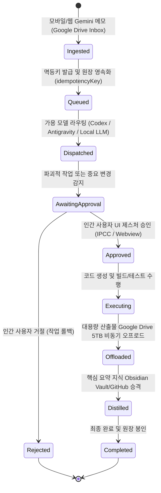

# 에이전트 비자율성(Non-Autonomy) 대응 내구성 브로커 프로토콜 규약

## 1. 핵심 철학: "에이전트는 자동화된 요소가 아니다"

일반적인 오해와 달리, AI 코딩 에이전트는 24시간 자율적으로 살아서 시스템을 운영하는 무한한 프로세스가 아닙니다.
현실의 에이전트는 다음과 같은 구조적 제약을 가집니다:

1. **휘발성 세션 (Ephemeral Session)**: 에이전트는 외부 트리거(사용자 프롬프트, 웹훅, CLI 배치)가 주어질 때만 순간적으로 활성화되는 단발성 추론 인스턴스입니다.
2. **비결정성과 실패 가능성**: 컨텍스트 윈도우 초과, 토큰 쿼터 고갈, 네트워크 타임아웃, 잘못된 도구 파라미터 호출 등 언제든 실패하거나 중단될 수 있습니다.
3. **권한의 한계 (권한 위임 불가)**: 에이전트는 시스템의 핵심 변경(파일 영구 삭제, 외부 원격 푸시, 금전 결제, 브랜치 병합)을 스스로 승인(Self-Approval)할 권한이 없습니다. 프롬프트 인젝션이나 환각으로 인한 재앙을 방지하기 위해 승인 권한은 오직 인간 사용자에게만 귀속됩니다.

따라서 **브로커(Broker)**는 에이전트가 "언제든 죽거나 멈출 수 있고, 언제든 실수할 수 있다"는 전제 하에 시스템의 상태 보존, 멱등성, 승인 통제를 완벽히 책임져야 합니다.

---

## 2. 내구성 있는 7단계 태스크 생애주기 (7-Stage Durable Lifecycle)

### 단계별 상세 규약

1. **인입 (Ingested)**:
   - Google Drive `IntegratedPower/Inbox`에 적재된 문서/메모를 `DriveIngestionService`가 감지.
   - 파일별 고유 ID 기반으로 `idempotencyKey: gdrive_inbox_{fileId}`를 부여하여 네트워크 재시도나 재인입 시의 중복 생성을 원천 차단.
   - 인입 성공 즉시 원본 파일은 `Inbox/processed/`로 원자적 이동.
2. **큐잉 및 영속화 (Queued)**:
   - 브로커의 암호화된 원장(`EventLedger`)에 `task.created` 이벤트로 기록.
   - 에이전트가 즉시 가용하지 않거나 시스템이 재부팅되어도 큐는 손실되지 않고 보존.
3. **디스패치 (Dispatched)**:
   - 토큰 잔여량 및 로컬 VRAM 상태에 따라 최적의 모델(Codex, Antigravity, Local Ollama/vLLM)로 라우팅.
4. **인간 승인 체크포인트 (AwaitingApproval - 절대적 셀프 승인 차단)**:
   - 파일 삭제, git push, 외부 통신, 결제 관련 작업은 즉시 `awaiting_approval` 상태로 일시 중단.
   - **에이전트 셀프 승인 차단**: 모델 프롬프트나 MCP 툴은 `/approve` 엔드포인트를 호출할 수 없으며, 오직 IPCC 데스크톱 UI 또는 IDE 패널의 물리적 사용자 클릭 인터랙션으로만 승인/거절 가능.
5. **실행 및 검증 (Executing)**:
   - 격리된 작업 디렉터리에서 빌드 및 테스트 수행. 에이전트 비정상 종료 시 재개 포인트(`revision`) 제공.
6. **대용량 아티팩트 오프로드 (Offloaded)**:
   - 수십~수백 MB의 VSIX 번들, 브라우저 QA 녹화 영상(WebP/MP4), 거대 로그는 로컬 SSD나 Git에 쌓지 않고 Google Drive 5TB 클라우드로 비동기 오프로드.
   - 원장에 영구 `webViewLink` 기록.
7. **지식 승격 (Distilled to Knowledge)**:
   - `DriveKnowledgeDistillationBridge`를 통해 태스크의 문제 정의, 아키텍처 결정(ADR), 핵심 요약만을 추출.
   - 대용량 산출물의 드라이브 다운로드 링크를 첨부하여 가벼운 마크다운 문서로 변환.
   - Obsidian Vault (`D:\obsidian\00 Inbox\`)로 저장되어 GitHub `eggr-knowledge`로 커밋/푸시.

---

## 3. GitHub 지식 저장소와의 상호보완적 분리 규약

| 구분 | GitHub 지식 저장소 (`eggr-knowledge`) | Google Drive (5TB 클라우드) |
| :--- | :--- | :--- |
| **역할** | **정제된 두뇌 (Curated Brain)** | **대용량 보관소 & 원천 인입함 (Heavy & Raw Tier)** |
| **데이터 형태** | Markdown (`.md`), 요약, 개념, 인덱스 | `.vsix`, WebP 녹화 영상, 대용량 로그, 원본 첨부파일 |
| **용량 관리** | 수 KB ~ 수십 KB 단위로 극도로 가볍게 유지 (Git 한계 보호) | 5,120 GB의 대용량 클라우드 버퍼 활용 |
| **연결 방식** | 본문 내 `webViewLink` 포인터 마크다운 링크 삽입 | 원본 바이너리 저장 및 영구 웹 뷰 링크 발급 |
| **버전 관리** | Git 커밋/diff를 통한 정밀한 지식 진화 추적 | 단순 클라우드 보관 |

---

## 4. 장애 복구 및 재시도 (Fault-Tolerance)

- **에이전트 중단(Crash) 복구**: 에이전트 프로세스가 죽더라도 브로커 원장에 기록된 태스크의 마지막 `revision`과 상태를 기반으로, 브로커 또는 IPCC에서 "작업 재개(Resume)" 또는 "보류(Hold)"를 안전하게 명령할 수 있습니다.
- **오프라인 동작**: 인터넷이 끊겨 클라우드 LLM이나 Google Drive에 접근할 수 없는 경우, 브로커는 작업을 로컬 큐에 보류(`offline_buffered`)하고 로컬 LLM(Ollama/vLLM)으로 처리하거나 네트워크 복구 시 재시도합니다.
